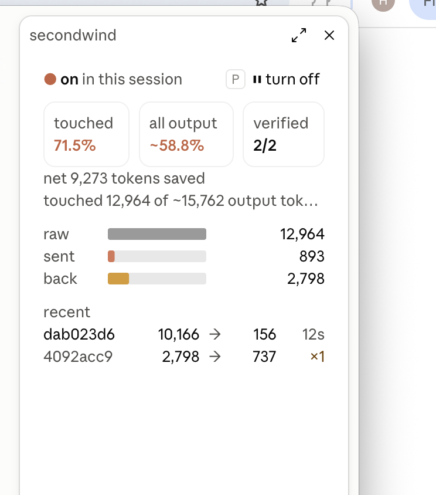

# secondwind in Claude Code

The mod in [`integrations/claude-code`](../integrations/claude-code) runs secondwind inside Claude
Code. It hooks each tool call after the tool has run, so the command itself, its quoting, its exit
code and its permission prompt are untouched; only the text the model reads changes. The earlier
Bash hook rewrote commands before they ran, which is where the double shell parse of issue #3 came
from and why it had to allow every command.

<p align="center">
  
</p>

## Install

The `secondwind` binary must be on `PATH` (the repository README covers that). Then, at the
prompt of a terminal session:

```
/plugin install secondwind --marketplace orchetron/secondwind
```

Answer `y` to add the marketplace and pick the user scope. From a shell the same install is
`claude plugin install secondwind --marketplace orchetron/secondwind`. In the desktop app, click
`+` next to the prompt box, then Plugins, add the marketplace `orchetron/secondwind`, then add the
plugin.

## Turn it on where you want it

Compression is off in every session until you turn it on there; other sessions are unaffected.

| action | how |
| --- | --- |
| on / off for this session | `/secondwind on`, `/secondwind off`, or the pane's `turn on` / `turn off` button (hotkey `p` while the pane has focus) |
| figures as text | `/secondwind status` |
| clear this session's figures | `/secondwind reset` |
| open the pane | `/secondwind` |

The status line under the chat reads `secondwind off`, `secondwind on`, or the net percent once a
block has been compressed.

## What happens to a result

1. A Bash result of 6 KB or more is sent to `secondwind mcp`'s `optimize` tool. Smaller results,
   errors and `stderr` pass through. Claude Code caps a Bash result at 30,000 characters before any
   plugin sees it, so the mod compresses what remains.
2. The model reads the stub the optimizer returns: a shape-aware preview (a diff summary, a match
   map, a JSON index, a prose digest with its gaps marked) ending in a `<<swload:...>>` marker.
3. When the model needs the rest it calls `resolve` with that marker, whole or by slice
   (`L10-40`, `[3]/title`, `number=42/body`). The mod hooks that call and books the tokens that
   came back against the savings.

Only the output goes through secondwind. Prompts, replies, the system prompt and other tools'
results are never compressed.

## Reading the pane

| figure | meaning |
| --- | --- |
| **touched** | net saved as a share of the tokens secondwind compressed |
| **all output** | net saved as a share of every tool result the model read this session, compressed or not |
| **verified** | compressed blocks the binary verified lossless, out of blocks compressed |
| **raw / sent / back** | tokens in, tokens sent instead, tokens resolves handed back, on one scale |
| **recent** | the last markers with tokens in and out, how long ago, and `×n` when one was reopened |

Net is raw minus sent minus handed back. A block the model resolves in full costs the stub on
top of the original, so it shows as a negative net, in red. Lossless and net are different
questions: the first is about information, which is always recoverable; the second is about the
token budget, which depends on how often the model needs the full text.

Compressed blocks carry exact token counts read from the binary's ledger. Everything else in the
"all output" total is a byte estimate, marked `≈`.

## Limits

- Bash results only, 6 KB and up, after Claude Code's own 30,000-character cap.
- Figures are per session and live in the session's state; `secondwind watch` and the web
  dashboard read the binary's lifetime ledger instead.
- The pane draws on the terminal and desktop surfaces; the bars are images on the desktop and
  rules in the terminal.

## Develop

```sh
claude plugin validate integrations/claude-code
claude plugin test integrations/claude-code
```

Edits to a plugin installed from this repository reach a session after `/reload-plugins`.
